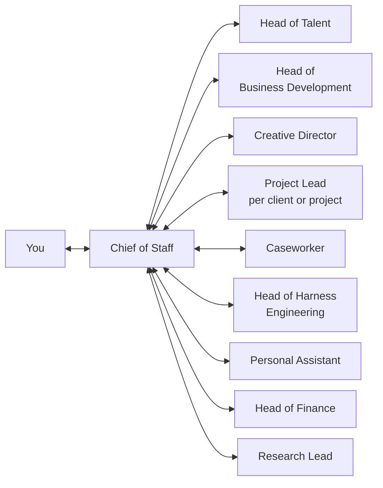
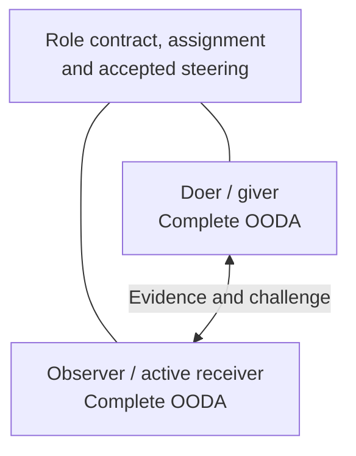

# Sovereign OODA Harness

**Private alpha.** No public installation release date is confirmed.

## Start here: the harness at a glance

1. **Purpose.** A personal operating system and second brain connecting knowledge, specialist capabilities and follow-through in service of agency, freedom of action and expression. [Purpose](#1-purpose).
2. **Method.** Recursive OODA: continuing observation, orientation, decision and action across connected participants and scales, shaped by evidence and responses from the world. [Recursive OODA](#recursive-ooda).
3. **People and agents.** You set direction and retain consequential decision authority. Each enduring role combines two complementary agents around its shared definition, private application and system-wide axis. [Roles and accountability](ROLES.md).
4. **Shared machinery and your private harness.** The shared and private harnesses work together so each sovereign can benefit from collective improvements while developing and protecting their own distinctive edge. Sovereign sleeves connect your private context and experience. [Shared and private harnesses](#shared-and-private-harnesses).
5. **Getting started.** Use the [included setup guide](docs/getting-started.md), select an accepted revision and supply your private context. Begin useful authorised work. [Current status](#3-current-state-and-getting-started).

[SOUL](SOUL.md) · [Ecology of mind](docs/ecology-of-mind.md) · [Repository guidance](AGENTS.md) · [Roles](ROLES.md) · [Skills](SKILLS.md) · [Lists](LISTS.md) · [Brand guide](brand/README.md)

Welcome to the real OODA Harness. OODA stands for Observe, Orient, Decide and Act. [John Boyd](https://slightlyeastofnew.com/wp-content/uploads/2010/03/essence_of_winning_losing.pdf) described its role in enabling us to “comprehend, shape, adapt to and in turn be shaped by an unfolding evolving reality that is uncertain, everchanging, and unpredictable.” OODA is a non-linear process of continuing reorientation and feedback, rather than a fixed sequence of four steps.

OODA Harness offers you a sovereign personal operating system and second brain that uses AI to extend your capabilities and strengthen your situational awareness. Sovereignty means owning your intelligence stack and using it on your terms. We are building a modular harness in which you retain what you have built while changing or augmenting the components that serve you. Its purpose is to give you control over your means of production, so your ability to be absurdly productive is not at the mercy of a single provider’s Trust & Safety decisions or the arbitrary consequences of geopolitics.

Like a Celtic knot, the harness’s system design intends to connect and extend capabilities so that work on one part can improve results elsewhere and strengthen the whole. The aim is to multiply the effect of your investment of time and attention, so you get more done with less. Reinvesting the capacity saved on execution can create further value, allowing the gains to compound. This gives you greater freedom and focus to express yourself in the world.

The harness helps you understand your own decision cycle too (1:Self), and operate within other people’s decision cycles, through individual interactions (1:1, dyadic), in group settings (1:Few) and across wider networks (1:Many). Scales of interaction, relationships and coordination [differ with group size](https://www.microsolidarity.cc/essays/five-scales-of-microsolidarity), and the social setting, including how public or private the encounter is (see Dark Forest Theory and the cozy web).

You operate within this distributed cognitive OODA field whether you are aware of it or not: a multi-nodal, massively modular network of self-organising, self-determining minds, hyperconnected through technology. Participants respond to the field’s selection pressures from their own understanding of the situation, without necessarily seeing the whole.

The harness is designed to give you a competitive advantage, to help you see and act within the wider system, to make the invisible visible, and to recognise this environment as a cognitive ecology you can learn to navigate and help shape. Greater situational awareness makes it more malleable to you: you can see where and how to intervene. We draw on [Noel Burch’s four stages of competence](https://www.gordontraining.com/free-workplace-articles/learning-a-new-skill-is-easier-said-than-done/) to guide your progression from unconscious incompetence towards unconscious competence as we develop the harness with you.

We are developing the harness’s theory of mind and cognitive empathy with you, to reason probabilistically from incomplete evidence and read between the lines. This includes how behaviour changes with the relationship and how public or private the interaction is.

The harness gives you an interface through which to engage intentionally with other people’s decision cycles. It supports diagnosis and intervention by considering whose OODA you are enabling, at what scale, and who is giving or receiving. For observation, the approach depends on your intention. Improving your own observation may call for intelligence and ingestion. Informing others’ observation calls for understanding active receivers’ field of view and horizon, so distribution can bring relevant information into view. The real action is the reaction: the active receiver participates in shaping the encounter, and their response helps determine what happens next.

You are the sovereign, the human in the loop. The harness is your right hand and AI thinking partner, extending your ability to see, decide and act. You are an active participant in the OODA harness. You review its interpretations and methods, retaining what proves useful so subsequent work can build on it. We establish the standard with your close involvement, and can reduce supervision of suitable work as the harness demonstrates reliable performance. Within the scope of your delegation, the harness carries your intentions and values into action and follows through on agreed work, including when you are away or asleep. Decisions that need your judgement are brought to you.

## 1. Purpose

**The human vision is the primary mover.** Your intentions, values and creativity give OODA Harness its purpose and direction. The harness exists to increase your agency: your ability to choose, express and act on those intentions and values.

Our aspiration is consummate mastery of our environment: the ability to understand the situation, act skilfully, communicate and realise that vision with increasing freedom, at scale.

We are developing capabilities so well integrated that they feel natural. Relevant knowledge comes to hand. Understanding carries through into action and expression, and experience deepens our judgement. These capabilities extend through our relationships, teams and wider networks, expanding what you can achieve with your time and attention.

Mastery is adaptive competence within the ecology. We participate intentionally in shaping our surroundings and remain responsive to what unfolds.

We draw on manoeuvre warfare as a strategic lens. The ambition is cognitive supremacy within this ecology: better orientation and effective action to recognise and shape opportunities, secure resources and increase sovereignty in service of your freedom of action and expression. This governs how the harness prioritises work in service of your intentions, values and creativity. Cooperation, negotiation and competition can each serve that aim as relationships and interests change.

1. **Increase what you can achieve with your time and attention.** Progressively automate suitable work within your delegated authority and to an agreed standard, creating capacity you can reinvest.
2. **Put knowledge and specialist capabilities to work.** Connect and apply relevant knowledge and capabilities to solve worthwhile problems beyond your own expertise, while developing your judgement and situational awareness. Extend your capacity for discovery by widening your field of vision and broadening your horizon. Retain useful decisions and learning so subsequent work builds on them.
3. **Bring you closer to people and communities.** Increase the chance of serendipitous encounters by helping you discover people and possibilities, and helping others discover you and your work. Enable shared work and projects that extend what you can achieve together, including the further value created by what your contributions enable others to do in turn.
4. **Give you freedom to express yourself.** Provide multimodal interfaces for speech, writing and images through which you can express your intentions, values and creativity in the way that suits you in the moment. Capture your meaning and context without interrupting your flow or making you fit a prescribed process.
5. **Give you sovereignty over your intelligence stack.** Preserve your freedom to switch models and control where your data sits and which services you trust. Keep those choices adaptable as circumstances change, without losing your working history or continuity.
6. **Build a coherent, accountable team of specialists.** Each role has a defined job and is accountable for results measured using the harness’s shared units of account.

### Shared and private harnesses

The **shared OODA Harness** provides reusable principles, common contracts, role templates, reference roles, skills and assembly guidance. It is the intended commons, currently a private alpha. Public release and licence selection remain separate decisions.

Your **private sovereign harness** is the personal implementation you maintain around a chosen shared revision: your profile, chosen team, customised responsibilities, private bindings and connections to projects and experience. It can reference shared definitions while retaining your own adaptations. The runtime hosts the actual agents; the repositories and other chosen stores preserve their guidance and continuity.

Use **OODA Harness** / `ooda-harness` for the shared foundation and `sovereign-<individual>-harness` for its private application. Use `sovereign-individual-harness` as the generic example and replace `individual` with the person's chosen identifier, for example `sovereign-alex-harness`. These names identify the harness; its private home can be a repository, folder or another chosen store. Adopting the convention in an existing installation requires reconciling its actual source routes and bindings through the [update path](docs/getting-started.md#update-an-existing-installation). A new name does not itself rename a repository or change an installed connection.

**Sovereign sleeves** are separately maintained configurations, knowledge or accumulated experience that you connect through your private harness to develop and protect your distinctive edge. A meaningful boundary of purpose, stewardship, access or lifecycle makes separate connection, maintenance or reuse useful. A customised role and its accumulated experience can have different lifecycles. One sleeve can connect several existing records; each file or case need not become a sleeve. Access, use and selective sharing remain subject to their actual owners' control.

The [role template](roles/ROLE-TEMPLATE.md#assemble-this-role) connects the two parts of a role's [combined governing basis](docs/ecology-of-mind.md#combined-role-basis). Its selected shared definition supplies reusable purpose, principles, responsibilities and methods. The sovereign's private contract applies that basis through their particular aims, judgement, relationships, knowledge and accumulated experience, recording the shared revision and deliberate adaptations. This private role sleeve develops through **active reception: interpreting, applying and learning, rather than copying**, grounded in the sovereign's steering and actual work.

Together with the relevant system-wide units of account, these parts govern one role and supply its nucleus. Both Twins receive that whole basis, the referenced common rules, current brief and relevant authorised sleeves. The private contract connects experience and source owners; it need not contain all their records. The current brief holds the changing assignment, priorities and measure values. [ROLES](ROLES.md) records shared reference-contract availability; where one is absent, use the template and common contract as the shared starting definition. The [Chief of Staff reference](roles/chief-of-staff.md) and [synthetic example](examples/perception-check-role.md) illustrate the relationship without establishing operation.

Keep the shared commons, sovereign configuration, independent projects and accumulated experience distinguishable for ownership and portability. A project can serve several roles and retain its own assets, history and client handoff arrangements. These boundaries differ from the overlapping Self, 1:1, Few and Many relationships described below. Neither requires rigid cognitive tiers or one repository per layer.

The reinforcing relationship is deliberate: sovereigns and their agentic teams adopt selected shared capabilities, use them in private work, retain useful results and corrections, then choose suitable general improvements to propose back. A contribution can be a method, configuration, defect report or permitted example. Check its evidence, dependencies and permission to share before the [existing review process](docs/pull-request-review.md). Accepted improvements become available for other sovereigns to adopt through the [update path](docs/getting-started.md#update-an-existing-installation), preserving their own customisations and experience. This is the intended meaning of **“Share the machinery, own the experience.”** Collective benefit remains to be demonstrated through use.

Use [private-harness assembly](docs/getting-started.md#create-or-connect-your-private-harness) to create or connect a small private home. Experience earns its value when relevant records and later corrections reach both participants and improve their work. Contribution and adoption do not imply automatic private-data export or repository synchronisation.

## 2. Work and intended outcomes

The harness is a map. What is the purpose of a map? To locate you. It maps the problems you want to solve to the capabilities you need, including those we need to create, to deliver the outcomes you want.

You are not alone. We are building an agentic team to serve you, with each role accountable for the value it delivers. Each role has a defined job and a contract specifying its responsibilities and intended results. A small set of shared measures, our system-wide units of account, connects those contributions to the outcomes you are pursuing.

This work may include:

- **Career, income and business development:** improve your career options, win paid roles or client work, and develop revenue streams.
- **Creative and intellectual work:** develop and express ideas, explore other disciplines, and produce work with support for editing and copywriting across different media.
- **Relationships and personal affairs:** sustain relationships, follow through on commitments and keep practical responsibilities in hand.
- **Finances and planning:** understand your financial position and plan how to use your resources in service of your priorities.

Reducing time spent on administration creates capacity for greater focus on worthwhile work and being present in your relationships. The work encompasses both what you accomplish directly and what your contributions enable others to do.

Assess progress against agreed outcomes. In a career campaign, suitable work at an agreed income is an outcome. Relevant interviews indicate progress. Sending applications is activity. These distinctions help you judge whether the work is creating value and where the approach needs to change. Numerical progress matters alongside relevance, quality and your intentions and values.

Maintained briefs hold the current objectives, targets, responsibilities, timeframes and results. They locate each assignment within the wider work, so roles can understand what they are contributing to and you can hold them to account. Section 5 maps the roles, skills and working records that support this structure.

## 3. Current state and getting started

### Current implementation

Here, “operating system” means the connected arrangement of working practices, roles, knowledge and AI capabilities around you. The harness began as a multi-nodal knowledge network in Notion. Its accepted reusable definitions now live in this package, with relative routes to their methods and references.

GitHub versions accepted definitions and methods. The intended Hermes deployment supplies the runtime, models and tools. The reusable package and configured private profile should carry the guidance needed for ordinary work without requiring access to the creator's private workspace. Live CRM, correspondence and project records remain in stores chosen by the sovereign and become dependencies of the assignments that need them. Some of Ben's existing workflows still use Notion; that is an installation binding, not a requirement for another sovereign's harness.

The first recorded private alpha snapshot is [v0.1.0-alpha.1](https://github.com/benohanlon/ooda-harness/releases/tag/v0.1.0-alpha.1). Draft-branch changes remain proposals until accepted. The [included setup guide](docs/getting-started.md) connects manual installation, first use, updates and recovery. Independent installation has not been demonstrated.

### Current status

The reviewed [common operating contract](docs/operating-contract.md), [role template](roles/ROLE-TEMPLATE.md), [ecology of mind](docs/ecology-of-mind.md) and [Sovereign Profile template](docs/sovereign-profile-template.md) are merged. Individual role implementation, connected workflows and supported interfaces remain under development. The Hermes rebuild has not yet demonstrated a working MVP. The immediate target is a small number of roles completing useful assignments with recoverable results and next actions.

Hermes setup checks on 2026-10-14 covered repository access and instruction loading for earlier definitions. They do not verify the current accepted package or useful paired work. The private setup history retains those checks; it is not needed to understand the portable method. Installation, loading and useful paired operation remain separate states.

No public installation release date is confirmed. Releasing selected elements or open-sourcing the wider harness remains a choice.

### Installation and configuration

The intended onboarding experience is one-click installation, with a short first-run step to connect the sovereign's context. This package is not yet a one-click installer.

Use [Getting started](docs/getting-started.md) for the first-install, update or recovery path, with [Codex](docs/runtimes/codex.md) or [Hermes](docs/runtimes/hermes.md) setup notes. Create or connect your [private harness](docs/getting-started.md#create-or-connect-your-private-harness), then use the [role assembly path](roles/ROLE-TEMPLATE.md#assemble-this-role) when commissioning an enduring role. Put confirmed routine answers in the private bundle rather than requiring another service to supply them. Add live connections when the assignment needs them. The creator's setup history is not a prerequisite for following the guide.

Finish each install, reinstall or refresh with the [private profile connection step](docs/getting-started.md#finish-installation-connect-your-private-profile). Reuse a working connection. If its location is unknown or access needs repair, ask the user and save their choice in that installation's private configuration.

### First useful interaction

Perception Check is the intended first diagnostic interaction. The first paired-role implementation starts with one bounded Chief of Staff assignment using Perception Check, then a bounded career assignment through Chief of Staff and Head of Talent.

**First intended task: [Perception Check](skills/perception-check/SKILL.md).** Ask, for example: “Run a Perception Check for the past 72 hours. What needs my attention?”

Establish the horizon and sources actually accessible. Distinguish access from observation. Bring useful findings, unfinished work and decisions into view, with material coverage gaps. The check should remain useful with partial connections; deliberately excluded private accounts remain boundaries to respect.

The method is prepared; live loading, source access and useful execution remain unverified. Retain the report, decisions and next action so later work can resume. Judge usefulness through the actual assignment.

## 4. Operating model

We are building a small agentic team around the work you need done. Each role has a clear purpose and a contract defining its responsibility and authority. We add roles when the work needs a distinct owner. OODA governs how the team works, connecting what agents encounter and do in the field with your evolving understanding and intended outcomes.

### Recursive OODA

OODA Harness deliberately uses a **recursive OODA pattern**. The sovereign and each agent retain their own complete OODA. Reciprocal engagement connects these OODAs within a role and across the team, the sovereign's activity and the wider environment. An observation, interpretation, decision or consequence at one scale can reorient work at another. The [ecology of mind](docs/ecology-of-mind.md#loops-within-loops-across-overlapping-relationships) explains these overlapping feedback relationships.

Complementary vantage points help make this pattern useful. At role scale, two actual agents form a **cognitive dipole** around the nucleus of shared purpose, contract, accountability and system-wide units of account. Their complementary polarities can reverse while each retains a complete OODA. Smaller processes, temporary crawlers and wider relationships contribute without requiring a two-agent structure at every scale. See the [atomic operating unit](docs/ecology-of-mind.md#the-atomic-operating-unit).

At harness scale, reusable shared methods and private knowledge, judgement and experience provide complementary resources around the sovereign's aims. Within each role, both Twins orient around the [combined role basis](docs/ecology-of-mind.md#combined-role-basis). The shared/private distinction does not assign one agent to each repository.

### Team and accountability

You set the aims and values and retain authority over consequential commitments. [Chief of Staff](roles/chief-of-staff.md) is your fiduciary, trusted right hand and principal interface to the team, extending your abilities and freedom of action. Its overarching OODA connects specialist work and returns to your aims, shared measures and changing circumstances, reorienting authorised work as evidence changes. Specialist leads own their work and may delegate bounded assignments to agents, who report to their assigning lead. You can work directly with any role. Roles exercise initiative within their authority, bringing decisions that need your judgement to you.

**Agreed team structure**

The diagram shows the ten agreed role types and their default delegation and reporting relationships: assignments go out and field reports return. Chief of Staff receives material outcomes, blockers and decisions needed, without becoming a routine approval gate. Each enduring role is designed as a pair, described below. The chart does not imply ten deployed roles or twenty always-on agents. Most individual role contracts and all paired-role deployment remain under development.

**First implementation.** Start with Chief of Staff and Head of Talent completing one useful assignment. Head of Harness Engineering is responsible for the build and its reliability. Introduce the remaining roles as their work and contracts are established.

Head of Finance will own financial planning, including portfolio and risk analysis. Its contract will define the detailed remit and authority.

[Research Lead](roles/research-lead.md) owns commissioned inquiry, exploratory discovery and the organisation of useful research. It has its own pair; other roles retain their domain decisions and can conduct research themselves.

The team coordinates around a small set of system-wide units of account, drawing on [Numbers come before strategy](https://ecosystemoperator.substack.com/p/numbers-come-before-strategy). These establish a shared axis around which strategies, tests, proposals and schools of thought can contend. Each role is accountable for its contribution against those shared measures. Its contract records the measures it is responsible for and defines the supporting metrics used to judge its work. Where recommendations compete, Chief of Staff brings the evidence and consequences for the whole together for the relevant decision owner to resolve.

### Two agents within each role

Each enduring role is an atomic operating unit comprising two agents around one [combined role basis](docs/ecology-of-mind.md#combined-role-basis): its selected shared definition, private application and relevant system-wide axis. We call this arrangement a cognitive dipole, also known as the Twins. It has one outward accountability. Both begin with the same relevant specification, guidance, context and available capabilities. They adopt opposite, complementary relational roles, or polarities: doer/giver and observer/active receiver. These positions may reverse without changing the enduring role or governing basis. Each has a complete OODA. Both can investigate, interpret, challenge and revise the other's understanding while work proceeds.

The shared basis keeps the work coherent while each agent's provisional interpretation remains distinguishable. One named participant owns each shared write or external action. Their exchanges inform the work and can reveal a need to reconsider its framing or standard. Changes to agreed aims or criteria follow the existing decision authority. A final-only critic or an unused second agent does not fulfil this design. Temporary workers, tools and skill calls do not each require another enduring pair.

The [ecology of mind](docs/ecology-of-mind.md) explains this atomic arrangement, smaller cognitive contributions, useful retrieval and the wider feedback circuit through the sovereign and environment. The [common operating contract](docs/operating-contract.md) defines decision rights, checkpoints, correction, recovery and feedback. [Sense of Taste](skills/sense-of-taste/SKILL.md) provides a judgement method within the pair. Specialist acceptance and whole-system review retain their distinct jobs. The [synthetic CoS/Perception Check](examples/perception-check-role.md) walks through the role template and reciprocal work. The [research assignment](examples/research-assignment.md) shows another application, including disagreement and interrupted work. These are document walkthroughs, not evidence of a running pair.

### Work in the field

Agents act as emissaries, extending your field of view and ability to act beyond what you can attend to personally. Each assignment names one accountable owner and defines its intended outcome, scope and delegated authority. Its task brief sets the required standard and who accepts the work. Field reports bring back observations and results, preserving evidence and uncertainty so the wider team can judge what follows. Their findings can challenge the assumptions they were sent out with.

Orientation is the working understanding that guides what the team notices and does. It combines fresh evidence with your aims, values, experience, knowledge and assumptions. Research and drafting can develop and test that understanding against outside evidence and perspectives. Each role considers how its actions affect the wider system.

The harness works with your OODA while each agent retains its own. The README, SOUL, role contract and current assignment help an agent establish its purpose, working context, methods and authority. Your private [Sovereign Profile](docs/sovereign-profile-template.md) helps the agents understand your aims, values, circumstances and ways of making sense of a situation. Together with current evidence and conversation, it can also help you examine your own assumptions and choices. Shared orientation develops through that interaction and is revised when evidence or your corrections change the picture. The profile records a partial, evolving understanding, checked against what you say, choose and experience.

Observation and reorientation continue while work proceeds. Work can begin at any point in OODA and move back and forth as conditions change. A bounded assignment may cover only part of it. Roles use established methods while their conditions fit and adapt within their authority when those conditions change. Waiting can be a valid decision while observation continues.

### Operating across scales

Within an assignment, the role considers whose OODA it is enabling, at what scale and in what setting. Your actions change the situation others respond to, and their responses change yours. Theory of mind informs the role’s reading of other people. Interpretations remain hypotheses to test through evidence, questions and responses. **The advantage is relational, not just internal speed.**

Discovery and ingestion support your observation. Distribution helps active receivers encounter your work within their field of view and horizon. What either party takes in can change their orientation and response.

| Scale of interaction | What to understand and enable |
| --- | --- |
| **1:Self** | Understand your own situation, aims, capacity, commitments and assumptions. |
| **1:1 (dyadic)** | Understand both people’s needs, incentives, gives and gets. Test your understanding of the other person’s perspective through questions and responses. |
| **1:Few** | Coordinate interdependent people or teams. Develop shared orientation: enough common understanding of the situation and agreed aims to act together. Make differing perspectives and incentives visible and connect local contributions to shared outcomes. |
| **1:Many** | Gather intelligence from wider networks and help relevant people encounter, understand and respond to your work. Distribution supports observation. Positioning, offers, résumés, onboarding and qualification can support orientation. Credible proof supports decisions. Clear asks and usable next steps support action. Shared outcomes and visible signals can support collective coordination. |

These scales overlap. Your own cycle continues throughout, and capabilities can support several OODA activities. An interaction can change your own understanding, affect a group and ripple through a wider network. How public or private the encounter is matters at every scale. Other people retain their own aims and decisions.

### Review and learning

Each role compares actual results with the intended outcome and expectations. A sent message and a useful reply are different results. Work can meet its acceptance conditions while its downstream effects remain pending. Keep observed effects separate from interpretations. Review the contribution to the whole, including effort and consequences elsewhere in the harness.

Proportionate independent review challenges consequential judgements and proposed improvements. Evidence can warrant changes to execution, methods, assumptions or success measures. Proposed changes to agreed aims return to their decision owner. Retain significant decisions, outcomes and useful learning in maintained records so subsequent work can build on them, including improvements to the harness itself.

A hiring manager’s response may overturn our initial reading of a role. We revise the assessment and choose whether to apply, propose a different mandate or stop, retaining the evidence and decision for later work.

[AGENTS.md](AGENTS.md) provides repository guidance. The [common operating contract](docs/operating-contract.md) defines the shared method; [individual role contracts](ROLES.md) define continuing responsibility and task briefs define individual assignments. Direct requests, agreed projects, research and delivery can enter through the relevant role without passing through opportunity discovery. The three opportunity loops in Section 6 sustain particular work within this wider operating model. Section 7 explains triggers and schedules. Section 5 maps the supporting components and records.

Foundation: [Boyd’s The Essence of Winning and Losing](https://slightlyeastofnew.com/wp-content/uploads/2010/03/essence_of_winning_losing.pdf), read alongside [Richards’s interpretation](https://slightlyeastofnew.com/wp-content/uploads/2010/03/boyds-real-ooda-loop.pdf). The interaction scales and capability examples are our application. Active receptivity draws on [McGilchrist’s discussion of Ruth Kastner](https://iainmcgilchrist.substack.com/p/quantum-physics-taoism-and-the-hemispheres); the intelligence and distribution mapping is our harness application.

## 5. System design and components

The following map records the capabilities and trade-offs identified through our research. It provides a reference for selecting and testing components as the harness develops. Several responsibilities may share an implementation. Each choice should be justified by the work it enables.

These components support the operating model in Section 4: keeping observation and reorientation active while work proceeds, and allowing results to change what happens next.

### Design considerations

| Area | What we need to consider | Principal trade-off |
| --- | --- | --- |
| **State, memory and context** | What needs to persist, where it is maintained, and how relevant knowledge reaches an assignment. Saving information, retrieving it and using it successfully are distinct requirements. | Enough context to support sound judgement, with manageable retrieval costs and clear boundaries around private information. |
| **Relationships and graphs** | How relationships between people, evidence, decisions and work are represented. Linked records may be sufficient. A graph representation may support more complex discovery and reasoning. | Richer relationships against the effort required to create, maintain and verify them. |
| **Models and decision methods** | Which work calls for ordinary code, a bounded decision model or broader model reasoning. Typed decision models such as Jev are an option for repeated semantic choices. | Quality, cost and speed for the particular task, including the consequences of different errors. |
| **Runtime, interfaces and access** | Where work runs, how instructions are loaded, and which tools and information are available through each interface. | Convenient access and continuity across interfaces, with enforceable boundaries around data and actions. |
| **Execution and coordination** | How work is assigned, dependencies are managed and results are combined. How progress survives interruption and uncertain outcomes are resolved before retrying an action. | Useful specialisation and parallel work against coordination costs, conflicting changes and recovery effort. |
| **Evaluation and learning** | What evidence establishes useful results, and whether changes to instructions, methods or components improve subsequent work. | The cost of checking and maintaining the system against improvements in quality and total human effort. |

The harness is a connected knowledge network with multiple entry points. A person, task, role, source or artefact can lead to relevant context. Cross-references connect that work to its purpose, governing instructions and supporting evidence.

A knowledge link explains a relationship. An execution dependency determines which work needs another result. Linking records does not automatically synchronise them or grant access. Keep each changing fact or decision with one maintained owner.

### Selected structure and current state

**Runtime and access.** Hermes is the selected deployment target. For each supported combination of interface, model and tools, we need to verify the routes for loading instructions, retrieving context and saving results. The common contract, CoS reference and Research Lead definition are prepared. Their presence does not establish runtime loading, paired execution or benefit; retain evidence and limits for each deployment separately.

The proposed access model gives the harness a dedicated email account and a defined working environment, with personal accounts outside that scope unless explicitly connected. A separate role, chat or directory does not by itself establish isolation. Account details and credentials belong in private configuration.

**Documents and reusable methods.** The document structure is:

| Document | Responsibility |
| --- | --- |
| [README.md](README.md) | The introduction and map: purpose, operating model, components, current status and routes into detailed guidance. |
| [SOUL.md](SOUL.md) | Shared identity, interaction, judgement and core communication principles. |
| [Sovereign Profile template](docs/sovereign-profile-template.md) | A reusable starting point for private personal context, working preferences and recurring answers. The completed profile lives in the sovereign's chosen private store. |
| [AGENTS.md](AGENTS.md) | Assignment orientation, repository guidance and routes to governing definitions. |
| [PR review guidelines](docs/pull-request-review.md) | Review changes in context, preserve intent, check useful connections and verify the result. AGENTS makes this part of finishing a PR. |
| [Short-film workflow](docs/short-film-workflow.md) | Workflow MVP for a complete first cut, character references, continuity and targeted revision. One 30-second film rendered with mixed audio; final quality and reuse remain unverified. |
| [Ecology of mind](docs/ecology-of-mind.md) | The atomic role, smaller cognitive contributions, reciprocal attention and wider feedback circuit. |
| [Common operating contract](docs/operating-contract.md) | Shared paired-role method, decision rights, assignments, recovery and learning. |
| [ROLES.md](ROLES.md) | A catalogue of agreed role types and available contracts, including Chief of Staff and Research Lead. |
| [Role template](roles/ROLE-TEMPLATE.md) | The assembly path and seven-section form for shared reference contracts and private role specialisations. |
| [SKILLS.md](SKILLS.md) | A catalogue of reusable skills linking to their instructions. |
| [LISTS.md](LISTS.md) | Routes into maintained collections, their purpose and when to retrieve them. |
| Each skill’s [SKILL.md](skills/perception-check/SKILL.md) | The method or knowledge for that skill, with supporting references, scripts or templates where needed. |
| [Writing and Editing](skills/writing-and-editing/SKILL.md) | The shared method for drafting, editing, review and advisory replies. |
| [Writing and Editorial Standards](skills/writing-and-editing/references/EDITORIAL-STANDARDS.md) | The detailed standard for meaning, evidence, argument, voice, revision and review. |

The `ROLES.md` and `SKILLS.md` catalogues and OODA’s role contracts are project conventions, not built-in Hermes features.

A role defines continuing responsibility. Its contract establishes accountability and authority. A task brief defines one assignment and its acceptance conditions. An agent carries out the work. Skills provide reusable methods or knowledge, loaded on demand. A reusable procedure can be packaged as a skill.

SOUL retains the core communication principles. Use [Writing and Editing](skills/writing-and-editing/SKILL.md) for drafting, editing, reviewing prose and giving advisory replies. The skill applies [Writing and Editorial Standards](skills/writing-and-editing/references/EDITORIAL-STANDARDS.md), which has one maintained home inside its package. Read that standard before the relevant work, reusing a current read during the task. Specialist workflows retain their production and execution steps. When delegating this work, pass the brief, accepted corrections and the skill and standard to the worker; [ROLES.md](ROLES.md#coordination-and-shared-skills) defines handover review.

Section 4 shows the agreed team structure. [ROLES.md](ROLES.md) records responsibilities, reporting and contract availability. [Chief of Staff](roles/chief-of-staff.md) has an accepted reusable reference and [Research Lead](roles/research-lead.md) has a prepared contract. The other individual contracts remain under development.

The [common operating contract](docs/operating-contract.md) owns the shared rules for evidence, authority, truthful completion and continuity. Catalogues provide routes to maintained definitions. [LISTS.md](LISTS.md) links the packaged community directory, selected research resources and existing editorial references. Role contracts explain when those methods and resources are useful. Private reading and ideas queues retain their existing owners.

Deployment follows [Hermes’s file and loading conventions](https://hermes-agent.nousresearch.com/docs/user-guide/which-file-does-what). Private profile and memory records remain separate from the reusable package. File presence alone does not establish that instructions are loaded or that access is available.

For Writing and Editing, deployment must make the complete skill package available to the intended Hermes profile and install its accepted SOUL. Current Hermes supports preloading the method through [`skills.auto_load`](https://hermes-agent.nousresearch.com/docs/user-guide/configuration#auto-loading-skills-every-session). Verify support in the installed version, loading in a fresh session, retrieval of the detailed standard and use in the actual output. Delegated workers need explicit guidance in their assignment. Installation, loading and live use of this editorial package remain unverified.

**CRM responsibilities.** Configure the sovereign's career and commercial record owners explicitly. In Ben's existing installation, Notion CRM holds companies, hiring sources, exact roles, qualification evidence, application history and career decisions; HubSpot holds commercial CRM, contact history, outreach and follow-up. This example preserves the existing two-offer pipeline without prescribing these services for another installation.

Relevant records can be linked while preserving their respective owners. This division does not establish automatic synchronisation or deployed email sending. Each assignment needs its applicable record boundary and current checkpoint; it does not need the creator's private planning history.

**Perception Check.** Perception Check is the first skill prepared for manual testing. Chief of Staff coordinates a review of available evidence, completed results and unfinished work. The review brings useful findings, outstanding decisions and coverage gaps into view. Its live usefulness remains unverified. No recurring Perception Check task is deployed. The detailed MVP workflow is maintained in [Perception Check](skills/perception-check/SKILL.md).

### Evidence and further development

Version history records which definition changed. Run evidence records what was attempted and what resulted. Use that evidence to diagnose the gap and choose a repair. Keep these records connected to the work and its owner.

The [common operating contract](docs/operating-contract.md) provides the portable method for evidence, correction and recovery. Its source history remains in the private “Master & component handover” and “Change Checklist”, which retain their private operating scope. Role contracts name their record owners. Section 8 explains how accepted portable revisions are promoted and distinguishes draft, publication and deployment states.

For each component, record the selected approach, its implementation state and the evidence available. Distinguish something proposed, something configured and something demonstrated through useful work.

Further development should answer concrete questions. For example:

- Does a different retrieval method recover and use relevant knowledge more reliably than our current approach?
- Does a graph representation improve discovery or coordination enough to justify maintaining it?
- Can a typed decision model handle a repeated judgement to the required standard at lower cost?
- Can an interrupted assignment resume with the current decisions, completed work and next action intact?

Compare proposed changes with the simplest suitable existing approach. Assess useful results alongside the time and attention required from you, including correction and recovery. Retain improvements that hold up in subsequent work. Revise or retire components that add burden.

The private construction guide, “How to build a harness”, and “Research decisions and supporting resources” retain the supporting evidence and alternatives for revisiting these choices.

## 6. Opportunity loops

These are three main areas of ongoing work within the harness. Their boundaries make clear what each covers and where it connects with the wider system. Work can also begin directly with any role, outside these loops.

**Closed Loop (Monitoring & Follow-through).** Monitor known sources and opportunities. Assess changes against previous evidence and decisions. Progress outstanding work towards an outcome. Registered hiring sources are one application. Preserve decisions already made and identify what needs attention next.

**Open Loop (Discovery & Ingestion).** Seek unfamiliar opportunities and bring in signals that could change the current working view. Investigate their relevance and reconcile them with what is already known. Findings may reveal worthwhile work, challenge an assumption or identify a source worth monitoring.

**Network Loop (Intelligence & Engagement).** Understand and develop relationships, identifying who matters now and why a conversation would be useful. Draw on relationship history and current signals to prepare relevant engagement. This includes collaboration and testing your understanding with others, as well as introductions and referrals. A useful conversation need not begin with a vacancy or request.

Work can move between these areas in either direction. Discovery may identify a source to monitor. A change in a known opportunity may give you a reason to reconnect. That conversation may reveal a new problem to investigate. One source can serve several loops, so reuse its findings.

Each scheduled assignment should identify the loop or loops it supports. The calendar shows planned work across these areas and the rest of the harness, so you can see where attention is being applied. An assignment serving several loops appears once, with those relationships recorded. Section 7 explains how work is activated and how we check what actually happened.

Results and responses test the working view and inform what to pursue, revise or stop. Carry unresolved work forward, preserving what has already been established. A pending response remains unknown. Available findings also inform Perception Check.

Here, *open* and *closed* distinguish discovery from work with known sources and opportunities. All three use feedback.

The networking loop supports the proposed, separately usable Hidden Job Market module. Export, enrichment and feed-reading work exists. The complete contact-to-referral route has not yet been demonstrated end to end.

## 7. Schedules and triggers

Direct requests, incoming signals and agreed schedules can activate work.

A schedule specifies the task, responsible role, cadence, execution context, authority and result destination. It supports the loops and other use cases. The private “Scheduled Work” directory holds the maintained schedule and invocation definitions.

The harness calendar gives you an overview of planned starts, with links to task definitions and result destinations. Runtime controls remain authoritative for execution schedules. Moving a calendar event does not reschedule the task. Automatic synchronisation is not deployed. Schedule changes require the corresponding calendar entries to be updated.

Scheduled work must preserve the ongoing conversation’s task and flow. Use a separate execution context. Retain results and unfinished scope in the existing task records. Report to the agreed destination without redirecting the interactive chat. Verify the execution and reporting route in the selected runtime.

Check configured state, actual execution, coverage, delivery and usefulness separately. A calendar entry or scheduled invocation is not evidence of completed work.

Ask for a Schedule Check to establish what is due, what actually ran and what needs attention. The method compares agreed commitments with available execution evidence and reports gaps. It is maintained within [Perception Check](skills/perception-check/SKILL.md), where it can be used independently or contribute to the wider situational review. Manual testing remains pending.

## 8. Development and sharing

Develop the harness through bounded changes grounded in real work. Start from a useful outcome or observed problem. Preserve working behaviour. Compare the change with the current approach. Check results and total human effort before deciding what to keep, revise or revert.

Use the [role template's assembly path](roles/ROLE-TEMPLATE.md#assemble-this-role) and [common operating contract](docs/operating-contract.md) to define and initialise a role within its commission. The wider construction guide, “How to build a harness”, remains a private working document. Under the operating model in Section 4, Head of Harness Engineering maintains the shared construction method and reviews whole-system alignment. Each role contract names its drafting and maintenance owner. Chief of Staff identifies capability gaps and reviews how roles fit together. The private “Build and prove the Harness Improvement loop” brief retains its wider development remit. Most individual contracts and portable deployment remain under development.

The next runtime milestone is to realise one pair in Hermes, starting with Chief of Staff and Perception Check, then a Talent handoff. Verify both agents' guidance and source use, reciprocal correction, accepted steering, action ownership and recovery. Compare useful results and total effort with a well-briefed single agent using the same evidence and standards. Retain adverse findings and test whether a saved correction improves a later assignment. See [runtime acceptance](docs/operating-contract.md#runtime-acceptance). Publishing these definitions does not complete that milestone.

### Shared design and knowledge principles

- **Separate instructions, collectors and verification.** Instructions define the work. Collectors obtain source data. Verification checks coverage, accuracy and results. These responsibilities remain distinct even when one agent performs them.
- **Separate evidence, interpretation and accepted guidance.** Preserve observations and provenance. Identify conclusions and proposals clearly. Repetition does not turn an interpretation into independent evidence or accepted guidance.
- **Maintain once.** Keep guidance, facts and work products with their maintained owners. Link to them. Retrieve current records. Return verified results to the appropriate destination.
- **Attribute adapted thinking.** Name and link the original source or maintained entry, its relevant section or version, and our adaptation. Distinguish primary work from later interpretation.
- **Make knowledge usable.** The README links essential guidance. Role contracts connect tasks to relevant resources and explain when and how to use them. Broader reading and history stay in the research library. Keep reading coverage, adoption and demonstrated usefulness distinct.

The [common operating contract](docs/operating-contract.md) carries the reusable review, correction and recovery method. The private “Master & component handover” and “Change Checklist” retain private procedures and change records. For repository work, read [AGENTS.md](AGENTS.md).

### Versioning and releases

Upstream development uses Notion for working design and review. GitHub versions accepted reusable definitions. Installed or forked use follows its accepted package and the sovereign's chosen records; it does not require the upstream design workspace. Promotion requires explicit agreement. Runtime deployment is a separate step.

On accepting a change, record the source and Git revision of each promoted definition. Update its existing private owner with a publication pointer while preserving design history and private operating instructions. The common contract, role template, Research Lead, skill methods and selected collections have explicit portable homes in this package. This does not transfer all Notion authority to GitHub. Existing assignments retain their accepted revision until deliberately updated; reconcile new steering from the sovereign wherever it affects the work.

Keep filenames stable. Git commits identify exact revisions. Release tags identify complete repository snapshots. Use [Semantic Versioning](https://semver.org/), with `0.y.z` and pre-release labels such as `v0.1.0-alpha.1` during initial development. After `1.0.0`, use patch releases for compatible fixes, minor releases for compatible additions and major releases for incompatible changes to documented contracts or interfaces. Keep published tags fixed.

Before publication, compare the candidate files with the approved draft. Afterwards, verify the published files. Retain the commit reference. Record the draft, published and deployed revisions separately. Verify runtime loading and useful execution separately before claiming either has succeeded.

### Sharing

The [shared/private contribution loop](#shared-and-private-harnesses) connects improvements from private work to this shared package. Review the selected contribution and its dependencies rather than exporting a private repository wholesale. Preserve the original project and experience owners.

Keep private personalisation, contacts, client records, credentials and runtime state outside reusable packages. Review selected files, history and dependencies before public release. Public packages must include accessible guidance and reusable dependencies without requiring access to the creator’s private workspace.

The Hidden Job Market module is intended for separate use and release. Publishing it does not require publishing the wider harness.

## 9. Origins

OODA Harness began through conversations with Claude and Codex, with Notion added as long-term memory. I gradually connected working methods, instructions, relationships and ongoing work around those conversations. The resulting harness supported thinking, writing and research, with Notion retaining decisions and next actions.

As the arrangement grew, responsibilities and guidance spread across different places. Individual parts could be useful while the design of the whole remained unclear. Important working history also accumulated inside separate applications, making it difficult to move between them. Dependence on provider-controlled models limited my control over how the harness behaved.

I began rebuilding around Hermes and GitHub to make that design intentional: understand the whole system, clarify how its parts work together, and preserve greater control over my knowledge, instructions and choice of models and interfaces.

[Inside my OODA](https://ecosystemoperator.substack.com/p/inside-my-ooda-a-bespoke-ai-harness) and the [existing schematic](https://ben-ohanlon-harness.bigkahunaburg3r.chatgpt.site/) document the earlier working arrangement.

## 10. Credit and licence

Created by Ben O’Hanlon, author of [The Ecosystem Operator](https://ecosystemoperator.substack.com/).

The operating model draws on John Boyd’s [The Essence of Winning and Losing](https://slightlyeastofnew.com/wp-content/uploads/2010/03/essence_of_winning_losing.pdf), read alongside Chet Richards’s interpretation, [Boyd’s OODA Loop (It’s Not What You Think)](https://slightlyeastofnew.com/wp-content/uploads/2010/03/boyds-real-ooda-loop.pdf) (2012). The harness adapts these ideas to human-led work.

[Hermes Agent by Nous Research](https://github.com/NousResearch/hermes-agent) is the selected runtime. Its official [user guide](https://hermes-agent.nousresearch.com/docs/user-guide/which-file-does-what) informs the file and loading conventions described here.

If you share or adapt the project, please credit Ben and link to the original project and newsletter. This is a voluntary request. The licence decision remains open.

[Original project](https://github.com/benohanlon/ooda-harness) · [Writing, resume and contact](https://linktr.ee/benohanlon)

---
