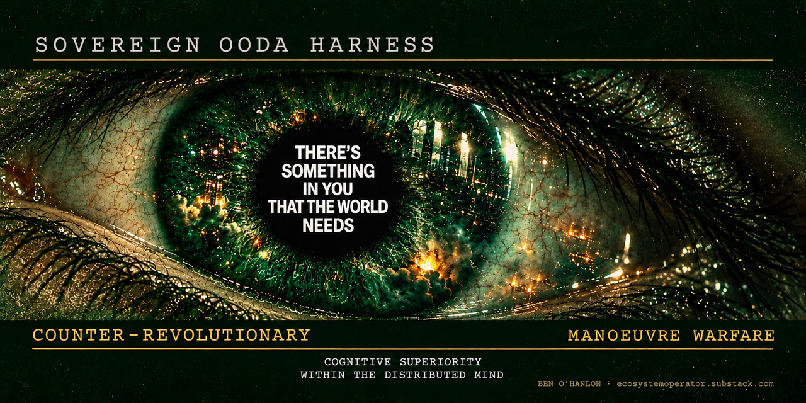

# Sovereign OODA Harness — design guidelines

Kit v1.3, published 22 October 2026. The approved cover remains v1.2, selected by Ben on 22 October 2026. It has no added authorship line, a softer title and NEEDS without a full stop. New editable layouts are prototypes until selected by Ben.

## Start with the approved artwork



[Master PNG](assets/sovereign-ooda-cover-master.png) · [GitHub JPEG](../assets/sovereign-ooda-cover.jpg) · [Reusable prompts](PROMPTS.md) · [Design tokens](tokens.json)

Use the approved image as the visual reference in every artwork brief. Reuse the existing asset whenever the task needs this cover. New generations are candidates until compared with it and accepted. The earlier blue, frontal-eye and pupil-position studies are exploration history.

## Identity and intent

Sovereign OODA Harness connects observation and orientation with human agency, sovereignty and the distributed mind. The artwork combines an intimate human eye with the pressure and complexity of the world reflected in it.

The emotional centre is the message inside the pupil: there is something in you that the world needs. Counter-revolutionary, manoeuvre warfare and cognitive superiority supply the strategic framing. Preserve the user's language.

The chosen look is cinematic, tactile, alert and human. Green carries the identity, gold carries structure and reflected light, and bone carries the message. Blade Runner's reflected-world eye informed the cinematic treatment; Nous/Hermes and Metalabel informed the earlier print and typographic research. The approved Sovereign OODA image is the reference for production.

## The eye

- Use a large emerald iris and dark pupil in an extreme close crop. Preserve natural anatomy and the intimate scale.
- Carry a diagonal sweep through the eyelids and lashes, falling toward the viewer's right. The intended reading is a slightly low, oblique viewpoint and attention caught by something below-right.
- Keep the eye as a fragment of a person in a moment of noticing. Preserve the tension, vulnerability and ambiguity of alertness or surprise.
- Reflect tiny city lights and distant amber-gold fire across the iris and corneal highlights. They suggest the surrounding world; they must not cover the pupil's words.
- Keep the pupil dark, the personal statement upright and complete, and the iris visually dominant.
- Match the approved image's visible geometry. Do not replace it with a frontal whole almond eye or treat sideways pupil movement alone as the solution.

The viewpoint is art direction and a perceptual reading. The benchmark itself resolves ambiguities more reliably than a verbal camera description.

## Colour system

These hex values are working targets for editable materials. The approved photograph contains a broad tonal range; they are not measurements of every generated pixel.

| Colour | Target | Use |
| --- | --- | --- |
| Forest dark | #07140F | Main background and negative space. |
| Emerald | #20784E | Eye and primary identity colour. |
| Sage | #A2BA91 | Lighter photographic detail. |
| Antique gold | #C6A45D | Rules, strategic labels and warm light accents. |
| Bone | #F1EBD7 | Pupil statement and cognitive footer. |
| Quiet bone | #C9C5B5 | Softer product title. |

Keep dark green dominant. Gold rules and labels are flat printed colour; gold reflections within the eye may glow naturally. Bone text stays clear against dark areas. Preserve the green-and-gold balance rather than shifting the whole image to orange, blue or cream.

## Approved cover typography

| Role | Editable specification | Treatment |
| --- | --- | --- |
| Product title | Courier New Bold; Courier or monospace fallback | Uppercase quiet bone, left aligned, generous tracking. |
| Pupil statement | Helvetica Bold; Arial Bold or sans-serif fallback | Uppercase, compact five-line block, centred in pupil. |
| Strategic labels | Courier New Bold; Courier or monospace fallback | Uppercase gold, left and right beneath the image. |
| Cognitive footer | Courier New Bold; Courier or monospace fallback | Uppercase bone, two centred lines. |

The approved raster approximates these letterforms and has no editable text or embedded fonts. These are production choices for future live typesetting.

Maintain this order of attention: personal statement and eye, product identity, strategic labels, cognitive footer. Check real display size; use live type when exact wording and spacing are critical.

## Editable template typography

The v1.3 prototypes use **IBM Plex Mono Medium (500)** for identity and supporting lines, and **Inter Bold (700)** for the pupil statement. IBM Plex Mono Regular (400) is available for metadata in the kit. The font files and complete SIL Open Font License texts are in [fonts/](fonts/README.md). These are reproducible production choices for the prototypes. They do not assert the exact fonts of the generated v1.2 raster.

The SVGs keep text and artwork separate. Font size, line spacing, alignment and coordinates are explicit. Use the [template instructions](templates/README.md) to render with bundled fonts. Check the resulting composition against the approved cover before proposing a new benchmark.

## Attribution

The approved cover has no embedded author name, handle, URL, signature or watermark. Keep origin credit in accompanying text and asset metadata, preserving the image's visual balance.

Creator: Ben O’Hanlon. Public destination: [The Ecosystem Operator](https://ecosystemoperator.substack.com/). The README already carries the project's creator and publication links.

## Canonical cover copy

Product name:

```text
SOVEREIGN OODA HARNESS
```

Pupil statement, five lines:

```text
THERE'S
SOMETHING
IN YOU
THAT THE WORLD
NEEDS
```

Strategic labels:

```text
COUNTER-REVOLUTIONARY
MANOEUVRE WARFARE
```

Footer:

```text
COGNITIVE SUPERIORITY
WITHIN THE DISTRIBUTED MIND
```

Retain the hyphen in COUNTER-REVOLUTIONARY and the British spelling MANOEUVRE: M A N O E U V R E. The final pupil line is NEEDS, with no full stop. Preserve the full statement and footer. New campaign wording should be an explicit brief choice.

## Composition and formats

The approved cover is 2:1. The eye image reaches the canvas edges; title, rules and lower text sit within approximately 4% horizontal margins. The photographic band occupies roughly 60% of the height. These are matching guides, not a substitute for the actual artwork.

The title sits above a thin gold rule. The eye fills the middle. Gold strategic labels sit beneath it, followed by a second gold rule and a two-line bone footer. The pupil is left of the canvas centre and contains the personal statement.

| Asset | Dimensions | Use |
| --- | --- | --- |
| Approved master PNG | 1774 × 887 | Preserve at native resolution as the benchmark. |
| GitHub JPEG | 1280 × 640 | README cover and repository social preview. |
| Future 2:1 master | Brief-specific; retain 2:1 | Produce new detail only when a larger source is needed. |
| Square or portrait adaptation | Set for its destination | Recompose the hierarchy and image crop; keep natural anatomy and complete chosen copy. |

Resize proportionally. Do not stretch the eye or crop away text to make a different ratio. A future larger export from this master is an upscale, not additional source detail.

GitHub recommends 1280 × 640 and a file below 1 MB for repository social previews. This is separate from README display sizing. Our JPEG is 495,146 bytes. [GitHub guidance](https://docs.github.com/en/repositories/managing-your-repositorys-settings-and-features/customizing-your-repository/customizing-your-repositorys-social-media-preview).

## Making coherent new artwork

1. Open the approved cover and this guide before drafting the brief.
2. State the asset's purpose, destination, ratio and exact copy.
3. Attach the approved cover as the main image reference. State the one or two deliberate changes.
4. Keep the palette, eye treatment, type contrast and hierarchy consistent. Let the reflected environment vary when the brief calls for it.
5. Compare the candidate beside the benchmark at full size and at its intended display size.
6. Check every word, the pupil's contrast, natural anatomy and safe margins. Record what changed.
7. Save candidates separately. Promote a new benchmark only after Ben selects it; retain previous approved versions.

Do not introduce generic HUD overlays, unrelated symbols, additional eyes, other organisations' logos or a new dominant palette. Keep the human message central.

## Approval check

- The image belongs to the same green, gold and dark visual family.
- The crop, iris scale and diagonal geometry preserve the moment of noticing.
- Reflected lights add atmosphere without obscuring the personal statement.
- The personal statement is the first clear textual read.
- Every chosen line is correct and legible at the intended output size.
- The image is proportionate, with no stretched anatomy or clipped wording.
- The brief's deliberate changes are clear; the benchmark has not silently drifted.

## Files and versioning

Kit **v1.3** adds the visual overview, colour and typography specimens, four editable layout prototypes, bundled fonts, render instructions and a downloadable ZIP. Cover **v1.2** remains the sole approved artwork benchmark. Template revision **0.1** is a production study.

Use [README.md](README.md) for previews and downloads. [PROMPTS.md](PROMPTS.md) holds reusable briefs; [tokens.json](tokens.json) holds design values; [manifest.json](manifest.json) records asset status, dimensions and checksums. Paths in the manifest are relative to the repository root.

The current approved master is [assets/sovereign-ooda-cover-master.png](assets/sovereign-ooda-cover-master.png). The repository README uses [../assets/sovereign-ooda-cover.jpg](../assets/sovereign-ooda-cover.jpg). Neither is replaced by a template export. The [download ZIP](downloads/sovereign-ooda-brand-kit-v1.3.zip) includes the complete brand directory and that JPEG, preserving their relative paths.

Git history preserves previous published versions. Notion retains approvals and exploration history. On an accepted kit revision, update the portable files and record the accepted commit in the existing Notion owner. Publication is separate from runtime deployment.

The clean eye is an AI-edited derivative prepared with the built-in image tool to remove flattened lettering and rules. Its [exact edit prompt](prompts/clean-eye-prototype-v1.3.txt) is included. It is a prototype source, not a pixel-identical restoration of the approved photograph. The original approved cover remains unchanged.
