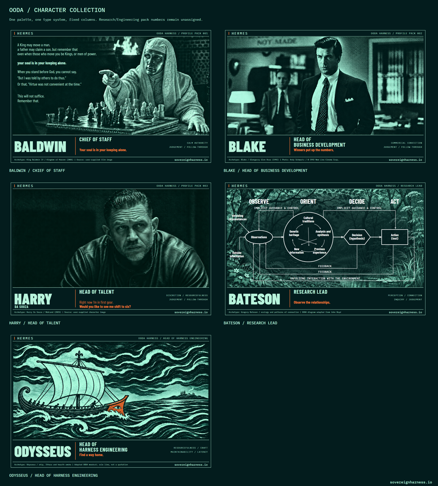

# Sovereign OODA Harness — brand kit

**Kit 2.1 · 10 November 2026**

[Download kit 2.1](downloads/sovereign-ooda-brand-kit-v2.1.zip?raw=true) · [Design guidelines](GUIDELINES.md) · [Editable sources and rendering](templates/README.md) · [Artwork prompts](PROMPTS.md)

One visual language connects the harness cover, character cards and architecture illustrations: dark petrol teal, pale mint, restrained orange, fine print texture and clear type hierarchy. Ben selected this direction from the Blake card and requested the wider kit update. Nous Research / Hermes informed the visual direction; these are OODA production choices, not official third-party brand specifications.

The eye remains the human centre: there is something in you that the world needs. Character cards express each role's temperament. Diagrams explain relationships. Their different purposes keep distinct layouts within the same family.

## Cover and layouts

| Asset | Format | Source or export |
| --- | --- | --- |
| Repository cover | 1280 × 640 JPEG | [JPEG](../assets/sovereign-ooda-cover.jpg?raw=true) |
| Lossless cover export | 1280 × 640 PNG | [PNG](assets/sovereign-ooda-cover-master.png?raw=true) |
| Cover and alternative layouts | Live SVG, four formats | [Sources and previews](templates/README.md) |
| Current kit | Sources, fonts, guides and exports | [ZIP](downloads/sovereign-ooda-brand-kit-v2.1.zip?raw=true) |

The full title, five-line pupil statement, strategic labels and cognitive footer are retained. Cover text is live in the SVG source. The clean eye is a separately generated, mint/teal photographic layer. Its print texture and geometry are reviewed visually; it is not a pixel-identical recolouring of the old image.

Kit 2.1 adds the destination URL at Ben's request. The [kit 2.0 archive](downloads/sovereign-ooda-brand-kit-v2.0.zip?raw=true) retains the preceding treatment. The 22 October cover and kit remain in Git history and the retained [v1.3 download](downloads/sovereign-ooda-brand-kit-v1.3.zip?raw=true). The earlier clean-eye source and prompt have an explicit [history home](history/v1.3/README.md). They are historical, not the current palette. A source or branding update does not refresh any installed harness or GitHub repository-setting social preview.

## Character cards

All cards use one 1536 × 1024 frame, fixed columns and real bundled fonts. [Card content](profile-cards.json) separates names, role titles, quotations, attribution and output paths from [shared tokens](tokens.json).

| Character | Role | Artwork | Numbering |
| --- | --- | --- | --- |
| Baldwin | [Chief of Staff](../roles/chief-of-staff.md) | [PNG](../assets/roles/chief-of-staff-baldwin.png) · [SVG](templates/profile-pack-001.svg) | Profile Pack 001 |
| Blake | [Head of Business Development](../roles/head-of-business-development.md) | [PNG](../assets/roles/head-of-business-development-blake.png) · [SVG](templates/profile-pack-002.svg) | Profile Pack 002 |
| Harry Da Souza | [Head of Talent](../roles/head-of-talent.md) | [PNG](../assets/roles/head-of-talent-harry.png) · [SVG](templates/profile-pack-003.svg) | Profile Pack 003 |
| Bateson | [Research Lead](../roles/research-lead.md) | [PNG](../assets/roles/research-lead-bateson.png) · [SVG](templates/profile-pack-research.svg) | Role label; pack number unassigned |
| Odysseus | [Head of Harness Engineering](../roles/head-of-harness-engineering.md) | [PNG](../assets/roles/head-of-harness-engineering-odysseus.png) · [SVG](templates/profile-pack-engineering.svg) | Role label; pack number unassigned |

Baldwin and Blake's numbers were specified by Ben; Harry follows his next-card request. Artwork numbering is a display convention, not an installer manifest, profile ID or proof of deployment. Research and Engineering remain deliberately unnumbered.

Harry's quote retains Ben's wording, including **six**. Its setup is regular weight and the second line bold, at the same font size. The Bateson and Odysseus short lines are role copy, not attributed historical quotations. Existing film/photo credits remain with their images; missing photographer details are not invented. Character inspiration does not change authority or professional standards.

## Architecture artwork

These are illustrations, not canonical architecture or operating instructions. [Ecology of Mind](https://github.com/benohanlon/ooda-harness/blob/main/docs/ecology-of-mind.md) and the [common operating contract](https://github.com/benohanlon/ooda-harness/blob/main/docs/operating-contract.md) govern their meaning. These repository references are outside the standalone artwork download.

| Illustration | Export | Editable source |
| --- | --- | --- |
| Ecology overview | [PNG](assets/sovereign-ooda-ecology-stack.png?raw=true) | [SVG](templates/ecology-stack.svg) |
| Selectively commissioned cognitive dipole | [PNG](assets/cognitive-dipole-v1.png?raw=true) | [SVG](templates/cognitive-dipole.svg) |

Both distinguish ordinary single-owner work from selective paired evaluation or high-value work. They do not establish runtime participation or benefit. The new vector sources keep labels and connectors maintainable.

## Colour and type

**IBM Plex Mono** carries headers and metadata; **Barlow Condensed** carries character names, role titles and quotations; **Inter Bold** carries the central human statement and diagram hierarchy. Font files are bundled with their licences in [fonts](fonts/README.md). The palette, role of each colour, sizes and spacing are in [tokens](tokens.json) and the [guidelines](GUIDELINES.md).

## Maintenance

Edit the data and SVG sources, then rebuild and inspect the exports. Do not use a new full-card image generation for a wording or spacing change: that reintroduces variation. Image generation is for the photographic/illustrative layer. Compare the collection at common size and at its intended viewing size. Preserve previous accepted work in version history.

[Manifest and checksums](manifest.json) · [Reusable prompts](PROMPTS.md) · [Rendering instructions](templates/README.md).

Created by Ben O’Hanlon, author of [The Ecosystem Operator](https://ecosystemoperator.substack.com/). Creator credit stays in metadata and accompanying text. A visible **sovereignharness.io** footer directs people to the project on all current shareable artwork, including the cover. Keep source-film/photo credits intact. [Public destination](https://sovereignharness.io/) is hosted separately from the private harness source.
