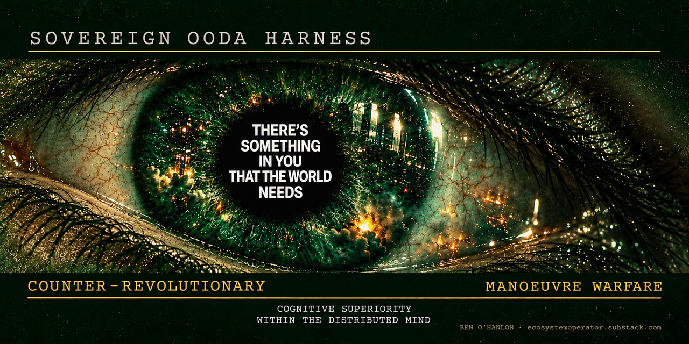
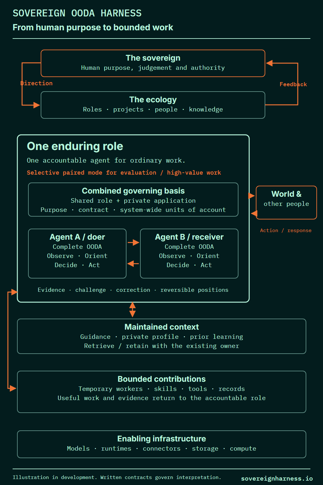
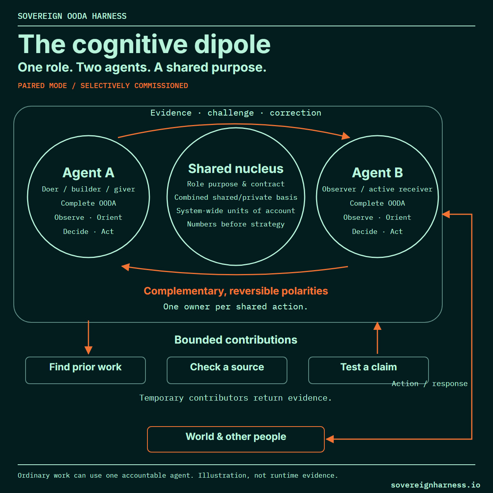
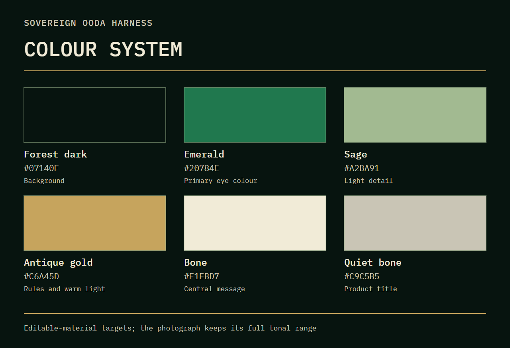
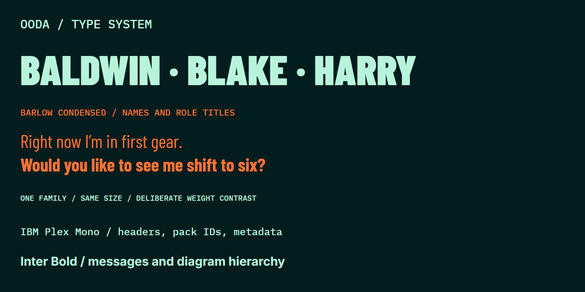
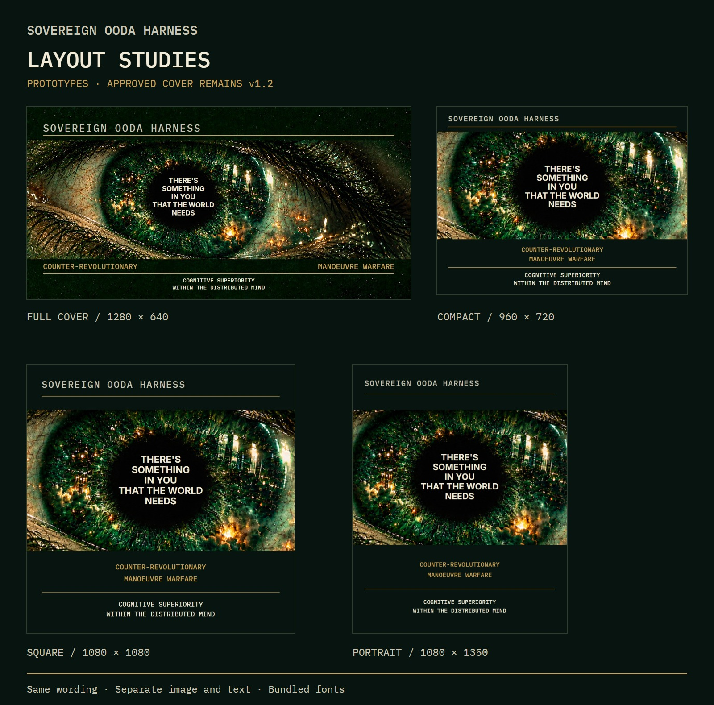

# Sovereign OODA Harness — brand kit

**Kit v1.3 · Approved cover v1.2 · 22 October 2026**

[Download published kit v1.3](downloads/sovereign-ooda-brand-kit-v1.3.zip?raw=true) · [Design guidelines](GUIDELINES.md) · [Editable layouts](templates/README.md) · [Artwork prompts](PROMPTS.md)

An intimate human eye caught in a moment of noticing. Dark forest green, an emerald iris, gold reflected light and a warm-bone statement inside the pupil. The human message leads; counter-revolutionary manoeuvre warfare and cognitive superiority within the distributed mind provide the strategic frame.

## Approved artwork

Use this cover unchanged when you need the established identity. It has no embedded author name or URL. Keep origin credit in accompanying text and metadata.

| Asset | Dimensions | Use | Download |
| --- | --- | --- | --- |
| Approved cover v1.2 | 1280 × 640, JPEG, 495 KB | Repository README; suitable dimensions for a social preview | [JPEG](../assets/sovereign-ooda-cover.jpg?raw=true) |
| Approved master v1.2 | 1774 × 887, PNG | Visual benchmark and source archive | [PNG](assets/sovereign-ooda-cover-master.png?raw=true) |
| Published kit v1.3 | ZIP | Artwork, sources, fonts, guides and prototypes | [ZIP](downloads/sovereign-ooda-brand-kit-v1.3.zip?raw=true) |

The repository README already displays the approved JPEG. GitHub's repository social-preview setting is separate. The JPEG meets its recommended 1280 × 640 dimensions and under-1-MB file size. See [GitHub's guidance](https://docs.github.com/en/repositories/managing-your-repositorys-settings-and-features/customizing-your-repository/customizing-your-repositorys-social-media-preview).

## Architecture artwork

These are illustrative studies, not canonical architecture or operating instructions. They may change as the design develops. The written definitions in [Ecology of Mind](../docs/ecology-of-mind.md) and the [common operating contract](../docs/operating-contract.md) govern interpretation.

The stack gives an overview for introductions and presentations. The cognitive dipole focuses on one role and is also shown in Ecology of Mind.

| Asset | Dimensions | Use | Download |
| --- | --- | --- | --- |
| Ecology stack v3 | 1024 × 1536, PNG | Illustrative overview; non-canonical | [PNG](assets/sovereign-ooda-ecology-stack.png?raw=true) |
| Cognitive dipole v1 | 1254 × 1254, PNG | Illustrative atomic role; non-canonical | [PNG](assets/cognitive-dipole-v1.png?raw=true) |

Added to the repository kit on 23 October 2026. The published v1.3 ZIP remains the 22 October snapshot and does not include these supplementary assets. Neither replaces the approved cover or establishes deployed paired operation.

## Colour

Green carries the identity, gold carries structure and reflected light, and bone carries the message. These are working targets for editable materials; the photograph retains a broad tonal range. [Colour values and roles](GUIDELINES.md#colour-system) · [Design tokens](tokens.json).

## Typography

The new editable studies use **IBM Plex Mono Medium** and **Inter Bold**, with bundled font files and licences. The approved raster's letterforms remain the visual benchmark. [Type specifications](GUIDELINES.md#editable-template-typography) · [Font files and sources](fonts/README.md).

## Layout studies

The compact landscape, square and portrait recompose the eye and type for their available space. Every study preserves the full chosen wording. Their text and artwork are separate, so future spacing and copy changes can be made precisely.

**Prototype status:** these layouts and the clean eye are production studies. The approved cover remains v1.2.

| Layout | Dimensions | Preview | Editable source |
| --- | --- | --- | --- |
| Full cover | 1280 × 640 | [JPEG](previews/cover-editable.jpg) | [SVG](templates/cover-editable.svg) |
| Compact landscape | 960 × 720 | [JPEG](previews/compact-landscape.jpg) | [SVG](templates/compact-landscape.svg) |
| Square | 1080 × 1080 | [JPEG](previews/square.jpg) | [SVG](templates/square.svg) |
| Portrait | 1080 × 1350 | [JPEG](previews/portrait.jpg) | [SVG](templates/portrait.svg) |

[Editing and rendering](templates/README.md) explains the linked source files and the reproducible exports. Compare candidates at their actual display size before selecting a new benchmark.

## Make related artwork

Start with the approved cover, the [guidelines](GUIDELINES.md) and the [reusable prompts](PROMPTS.md). State the destination, exact copy and deliberate changes. Preserve the eye's oblique crop, the green-and-gold balance, the dark pupil and the hierarchy of the message.

For text or spacing changes, use an editable layout. For photographic changes, use the approved image as the reference and keep new candidates separate until selected. Do not add watermarks, generic HUD graphics, unrelated symbols or other organisations' logos.

## Sources and maintenance

Created by **Ben O’Hanlon**, author of [The Ecosystem Operator](https://ecosystemoperator.substack.com/). The eye direction draws on the reflected-world imagery of Blade Runner; Nous/Hermes and Metalabel informed earlier print and typographic exploration. The approved OODA artwork is the production reference.

[Manifest and checksums](manifest.json) · [Design tokens](tokens.json) · [Exact clean-eye edit prompt](prompts/clean-eye-prototype-v1.3.txt).

GitHub holds this portable kit. The maintained approval and exploration record belongs to the project and its chosen store; Ben's existing record is in Notion. The kit's assets and guidance are included here. Git history preserves earlier published versions. Kit v1.3 improves presentation and reuse; it preserves the approved v1.2 cover.
