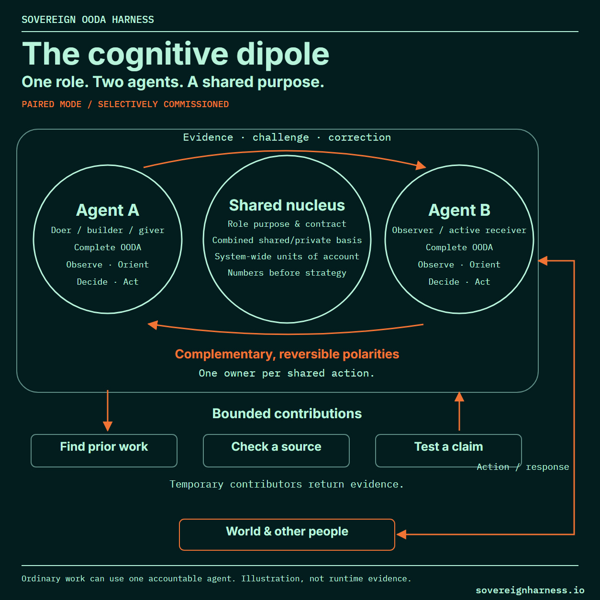

# Ecology of mind

**Status:** proposed shared architecture for review. This explains the design and its intended relationships. Paired operation and its benefits remain to be demonstrated.

OODA Harness extends the sovereign's ability to see, decide and act. Its roles, agents, methods, records and relationships form an ecology of mind: connected participants and resources through which understanding develops and useful action becomes possible. Its strategic ambition is better orientation and effective action that secure resources and strengthen sovereignty in service of freedom of action and expression. The [README](../README.md#1-purpose) sets out that purpose, including manoeuvre warfare and contextual cooperation, negotiation and competition.

The Twins form the atomic operating unit within that ecology. Their complementary perspectives, reciprocal engagement and feedback connect the smallest assignment to the wider purpose. The intended benefit includes less human effort spent supervising, correcting and recovering work. That benefit must be established through useful results.

## Illustrative view

*Illustrative study, not a canonical specification. This image may change. The written definitions below and the [common operating contract](operating-contract.md) govern interpretation.*

The nucleus represents the role's shared purpose, contract and units of account. Together with the two agents, it forms the atomic operating unit. Orbits depict complementary, reversible engagement; crawlers are temporary contributors outside the enduring pair. [Full-size image](../brand/assets/cognitive-dipole-v1.png) · [Brand asset catalogue](../brand/README.md#architecture-artwork).

## The atomic operating unit

Each enduring role comprises two agents and one shared contract, including the role description. This arrangement is a cognitive dipole, also called the Twins. It carries one purpose and outward accountability.

Both agents begin from the same relevant specification: model, available capabilities, governing guidance, role contract and starting context. They adopt opposite, complementary relational polarities: doer / builder / giver / emissary and observer / active receiver / reviewer. Both retain complete OODAs. Their experience and interpretations may differ as they work.

These positions are relational and reversible. Neither swapping nor divergence is the objective. Complementarity can continue when positions reverse. A change of polarity does not transfer permission to write or act. The [shared operating contract](operating-contract.md#one-role-two-oodas) maintains the detailed exchange, decision and action rules.

Here, atomic names the enduring role's working and accountability arrangement. Smaller processes can contribute to a decision: noticing a discrepancy, retrieving a relevant lesson, comparing interpretations or testing a possibility. The subatomic view describes these constituent contributions and their connections. Their useful boundary depends on the work and what their contribution changes. They can share context, memory and tools without each requiring a separate agent. Neither modular views of mind nor the polarity analogy establishes a universal minimum number of agents.

| Component | Contribution and boundary |
| --- | --- |
| Enduring role | Continuing responsibility, one contract and two participating agents. |
| Agent | A participant that observes, orients, decides and acts within its assignment. A replacement context can restore its work and relationship. |
| Model and context | The model supplies capabilities; the context holds the currently available guidance, evidence and work. Neither alone is the role's contract or durable continuity. |
| Skill, tool or smaller process | A reusable method, access mechanism or contribution to work. It need not become a separate agent. |
| Bounded worker or crawler | A temporary contribution commissioned within authority, returned to its assigning participant for integration. It need not become another enduring pair. |
| Brief, record and private binding | Current aims and decisions, retained work and evidence, or the configured route to a source or service, each with a maintained owner. |

The [seven-section role template](../roles/ROLE-TEMPLATE.md) specifies the enduring domain responsibilities and interfaces. The task brief supplies changing work, permissions, effort and acceptance conditions. Shared operating rules belong in the common contract, methods in their skills, and live state in existing work records.

## Complementary ways of attending

The design draws on Taoist complementarity, modular views of mind, and left/right and feminine/masculine modalities as conceptual inspirations. The engineering meaning lies in the different ways of attending that participants bring to a shared undertaking. These analogies do not prescribe sex, personality or a literal biological division between agents.

**The doer / builder / giver** turns understanding into proposals, artifacts, investigations and authorised action. It works with the material, discovers constraints and possibilities, and brings evidence of what happened. Execution can reveal that the brief, method or observer's interpretation needs reconsideration.

**The observer / active receiver / reviewer** receives and interprets the work in relation to its purpose, sources, audience and wider consequences. It gives cold and adversarial reads, checks relevant standards, and examines fidelity, regressions and effects elsewhere. It also investigates, discovers possibilities and helps shape what should happen next.

Receiving is itself productive. What the receiver notices, asks and makes of a proposal changes the encounter and what can emerge from it. The builder's response can change the receiver in turn. Each participant remains capable of creation and criticism. Their complementary emphasis sustains a relationship in which either can correct, surprise or reorient the other.

## Shared purpose and axis

Both participants need a working understanding of the role, its contract, the current assignment and its contribution to the whole. That understanding becomes observable through decisions and useful work.

The shared axis is the small set of system-wide units of account around which strategies, tests and proposals contend. [Numbers come before strategy](https://ecosystemoperator.substack.com/p/numbers-come-before-strategy): agreed definitions, current evidence and relevant baselines inform the strategy. Supporting role measures connect to those governing outcomes. Outcomes, progress indicators and activity counts answer different questions.

Consistent units let contributing roles assess their effects on the same outcome. Changing targets, timeframes and results belong in maintained briefs. Missing evidence remains a gap rather than an invented figure, weight or exclusion. Qualitative value, judgement, creativity and freedom of action remain part of assessing the result. Both participants can question whether a measure still serves the purpose. The existing decision owner retains authority over governing aims and measures.

For example, preferring remote work can affect prioritisation while worthwhile hybrid roles remain eligible. Turning that preference into an exclusion changes the sovereign's intention. The [synthetic Perception Check](../examples/perception-check-role.md) shows the doer correcting such a mistaken criticism while retaining a useful finding from the receiver.

## Loops within loops, across overlapping relationships

Each agent observes, orients, decides and acts. Their exchange becomes part of what each observes and can change either participant's orientation. The role's work contributes to projects, other roles and the sovereign's wider activity. Responses from people and the environment feed back across these relationships.

An exchange can affect personal understanding (1:Self), a relationship (1:1), a group (1:Few) and wider distribution or networks (1:Many) at once. These relationships overlap, with ripple effects across the network. A local improvement may strengthen another part of the harness; a local optimisation may also damage the whole. The distributed cognitive ecology already exists around the sovereign. The harness helps them navigate and shape it.

The role's accountability boundary and the circuit needed to understand an outcome can differ. A feedback circuit may include the sovereign, a pair, an earlier decision, a retrieval tool, an artifact, its recipient and a changed environment. Bateson's account of mental processes across person, tool and environment informs this distinction. Applying it here preserves the role's accountability while examining the wider relationships that make its work useful.

Observation and orientation continue during action. Familiar work can proceed through an established method within authority, while new evidence can prompt investigation, a different approach or deliberate waiting. No task needs a compulsory four-step OODA ceremony. Other actors' intentions, constraints, responses and timing also change the next move. Internal interpretation remains open to outside evidence and actual recipients' responses.

### The sovereign's own OODA

The sovereign and each agent retain their own OODA. A private Sovereign Profile, where available, supports a partial, revisable understanding of the person through stated guidance, relevant records and clearly identified interpretations. It does not contain the whole person or make an agent's interpretation the person's decision. The sovereign can correct the harness, reconsider an aim or introduce context that its records do not contain.

The human participates in the wider feedback circuit and retains consequential decision authority. They do not replace one of the two internal Twins. Likewise, an agent's proposed audience interpretation cannot stand in for an actual recipient's response. The common contract maintains [source and record ownership](operating-contract.md#source-and-record-ownership), while private profile content and its retrieval bindings stay with their existing owners.

## Memory, workers and useful retrieval

**The role develops through the agents' shared working history.** Continuity includes the evidence they have encountered, how they have changed one another's understanding, and the differences that remain unresolved. Resuming the role means recovering enough of that history to continue the relationship. “Entanglement” may serve as a philosophical analogy for this relational dependence; it does not describe a quantum mechanism. The common contract governs [checkpoints and restoration](operating-contract.md#work-checkpoints-and-restoration).

Continuity develops through relevant records retrieved and used in present work. A crawler can recover an earlier solution, accepted copy or changes in a service. Its contribution includes the context and later corrections needed to judge whether that material applies now. A retrieved example can be superseded, conditional or wrong. Finding it is only part of making useful sense of it.

Either participant can commission a temporary worker within the assignment's authority. A tool or script may suffice; an agent earns its place through the interpretation it contributes. This does not imply continuous crawling or recursive pairs. The [bounded-worker and prior-work retrieval rules](operating-contract.md#bounded-workers-and-prior-work-retrieval) govern those assignments and their handbacks.

The pair can question a worker's search, filters and interpretation, including a shared filter that excluded consequential evidence. Shared retrieval can save effort while independent examination can expose a shared mistake. A returned batch is not automatically relevant, correct or applied. Retrieval, appropriate application and useful effect remain separate observations.

## Reciprocal work, convergence and learning

Both participants work from the accepted basis and relevant original evidence. They engage while the work can still change. The receiver's discovery can change what the doer investigates, and the doer's evidence can overturn a mistaken criticism. Useful provisional exploration need not receive immediate criticism of every tentative thought.

Reconciliation connects new evidence with original intent, current steering, accepted decisions, previous lessons and actual outcomes. Convergence means a better-supported understanding and next action. Evidence can justify a repair, retention of sound work, investigation or a decision returned to its owner. Where the evidence does not settle a difference, uncertainty and alternatives remain visible. Agreement and the observer's title do not establish correctness.

The common contract owns the practical moves for [correction, review and learning](operating-contract.md#correction-review-and-learning): recover, challenge, reconcile, act and recheck, retain and reuse. They are selective moves during work. Prior learning remains open to examination without every assignment reopening every settled decision.

Single-loop learning improves work within current aims and criteria. Double-loop learning questions governing assumptions, framing, measures or aims. Either can occur during execution. The common contract attributes this distinction to Argyris. Bateson's learning levels inform the wider conceptual basis and are not exact synonyms for those two terms.

## Learning to need less supervision

The intended benefit is that the Twins catch and resolve more problems before the sovereign must reconstruct intent or repeat guidance. Evals make aspects of this assessable through actual artifacts, actions, resulting state and relevant work records. Exact conditions need exact checks; meaning, usefulness and quality also require calibrated judgement.

The observer is part of what needs evaluation. Missed failures, unsupported criticism, discoveries and harmful repairs all matter. Familiar successful cases can test preservation, while fresh comparable cases test whether a lesson transfers. Nuanced judgement can be calibrated against the sovereign's corrections and relevant domain expertise. Passing known cases cannot establish that every unnoticed distortion is gone.

Shared mistakes, habitual yielding and circular criticism are possible failures of the relationship. Reversing polarity alone does not cure them. Outside evidence, counterexamples and observed outcomes help distinguish productive engagement from agreeable or adversarial performance.

The [runtime acceptance](operating-contract.md#runtime-acceptance) compares paired work with a well-briefed single agent using comparable evidence, tools, standards and effort. Whole cost includes retrieval, coordination, duplicated work, tokens, delay and the sovereign's supervision, corrections and recovery. Reduced supervision follows demonstrated reliability in suitable work. Human judgement remains essential for direction, consequential commitments, unresolved decisions and calibration.

## Place in the harness

The [README](../README.md) introduces the whole design and its status. [AGENTS](../AGENTS.md) routes an arriving contributor or participant to the relevant guidance. [ROLES](../ROLES.md) and the [role template](../roles/ROLE-TEMPLATE.md) specialise the shared design for each domain. The [common operating contract](operating-contract.md) owns detailed assignment, action, checkpoint, restoration and evaluation rules. Skills supply reusable methods. Existing briefs, libraries, private bindings and work records supply current evidence and state.

These maintained links form a multi-nodal map for orientation. The current question can lead an agent to the role's accountability, the sovereign's aims, relevant evidence and methods, or an earlier correction. The [role template's knowledge routes](../roles/ROLE-TEMPLATE.md#4-capabilities-methods-and-knowledge-routes) explain when a source matters and what to retrieve. Private personal context is reached through the configured route described in [installation and configuration](../README.md#installation-and-configuration).

Metacognition here means examining how the available context, assumptions, evidence and methods shaped an interpretation or action. The [common learning method](operating-contract.md#correction-review-and-learning) connects that examination to decisions, observed results and the existing owner of a useful correction. The links support selective retrieval and reconsideration as the work changes. They do not require loading the whole harness or creating a second copy of each rule.

The [Perception Check walkthrough](../examples/perception-check-role.md) applies this structure to the first intended implementation path. The existing [research assignment](../examples/research-assignment.md) supplies another synthetic application. Neither establishes a running pair. Publication, acceptance, installation, actual loading, execution and demonstrated usefulness remain separate states.

## Basis

This is Ben's proposed harness architecture. Its conceptual inspirations, methods and empirical questions have different evidential roles:

- [Boyd's *The Essence of Winning and Losing*](https://slightlyeastofnew.com/wp-content/uploads/2010/03/essence_of_winning_losing.pdf) informs orientation, feedback and interaction with an unfolding environment.
- [McGilchrist's discussion of Kastner](https://iainmcgilchrist.substack.com/p/quantum-physics-taoism-and-the-hemispheres) is the retained giver/active-receiver and master/emissary inspiration. The polarity design here is a harness adaptation.
- [Bateson's *Steps to an Ecology of Mind*](https://ejcj.orfaleacenter.ucsb.edu/wp-content/uploads/2017/06/1972.-Gregory-Bateson-Steps-to-an-Ecology-of-Mind.pdf), the 1972 collection in its 1987 reprint, informs the wider feedback circuit and relational patterns. The review covered four complete essays with footnotes and selected original-page checks: *Culture Contact and Schismogenesis*, *The Logical Categories of Learning and Communication*, *Conscious Purpose versus Nature*, and *Form, Substance, and Difference*. This was not a whole-book read and does not establish the effectiveness of this AI arrangement.
- [Sense of Taste](../skills/sense-of-taste/SKILL.md) supplies the shared cold and adversarial review method, alongside specialist checks.
- [Saha and Husain's *Do Automated Evals Work?*](https://parlance-labs.com/blog/posts/auto-evals/) and [Anthropic's agent-evaluation guidance](https://www.anthropic.com/research/demystifying-evals-for-ai-agents) inform retained cases, missed failures, false criticism, grader calibration and inspection of actual outcomes.

Related precedents include [CAMEL](https://arxiv.org/html/2303.17760v2), [CAFE](https://arxiv.org/html/2608.24794v2) and [Lucas's *Evolving an Integral Ecology of Mind*](https://www.calresco.org/lucas/eiem.htm). Their agent arrangements, training mechanisms and evidential claims differ. They do not validate this exact design or establish its novelty. Its usefulness depends on what the implemented harness demonstrates.
